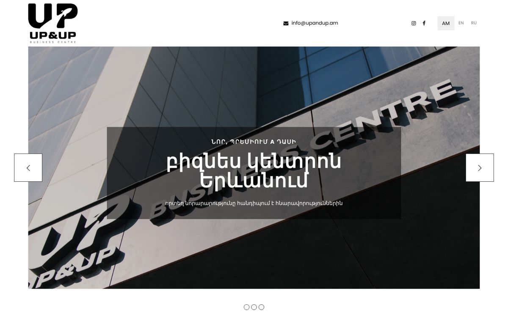
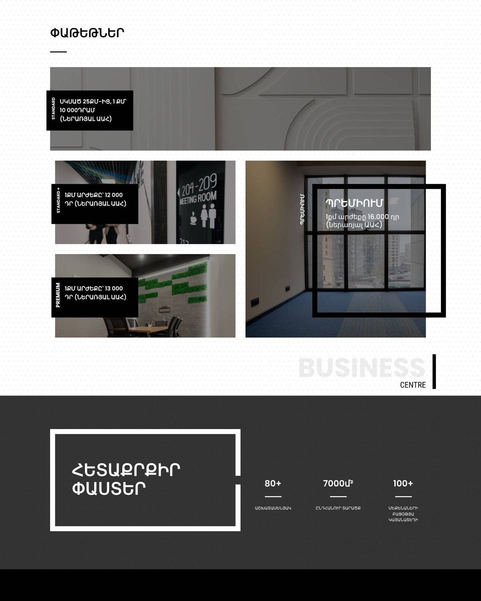
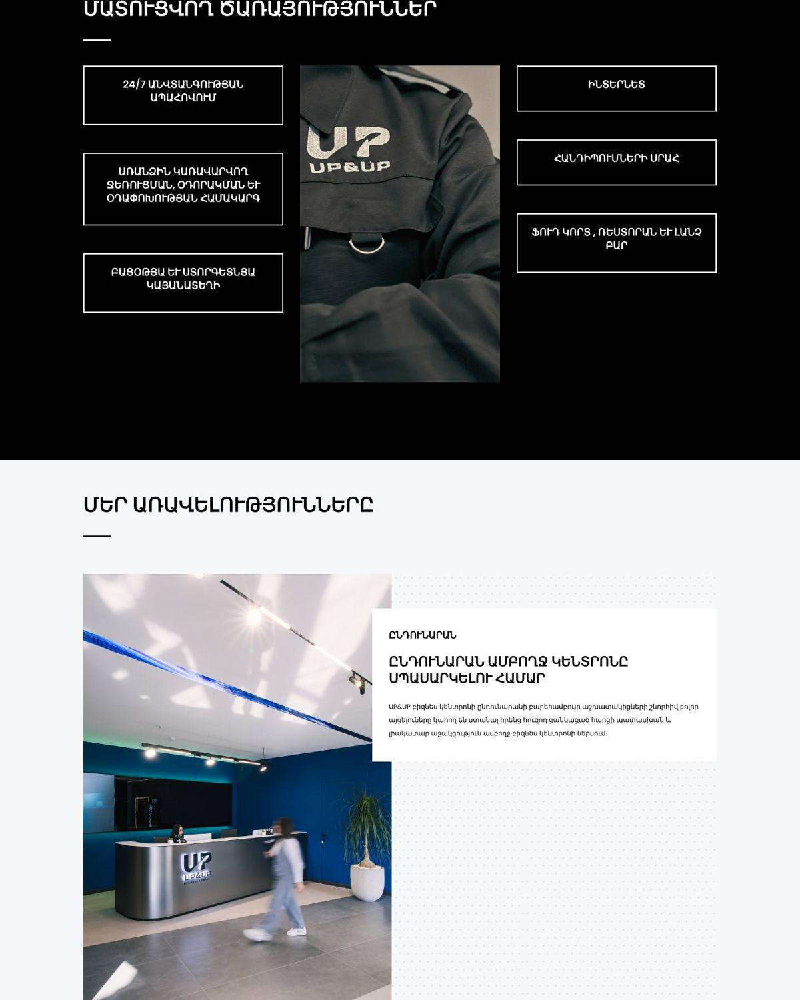
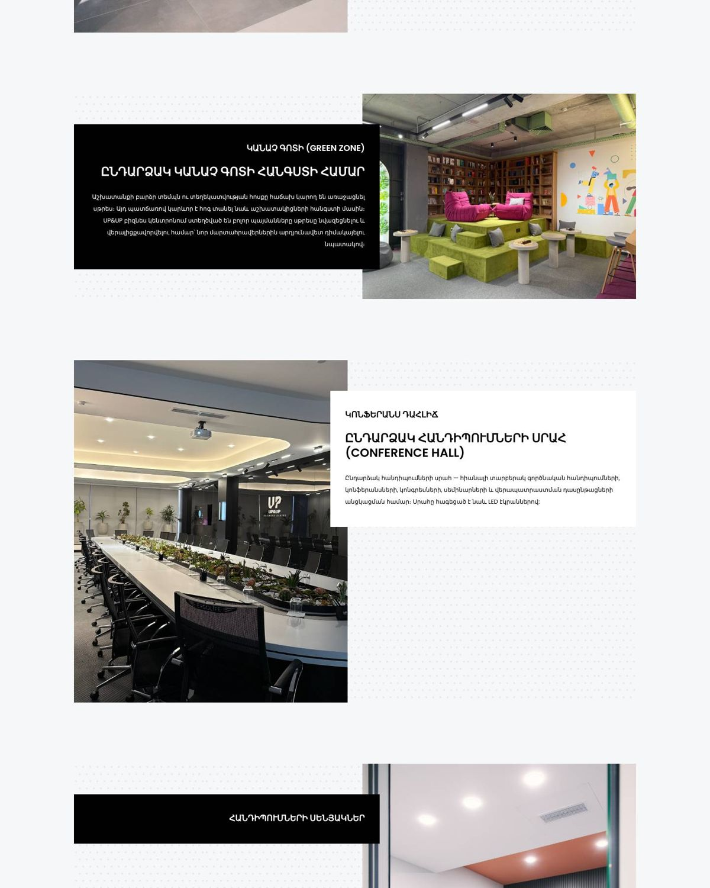
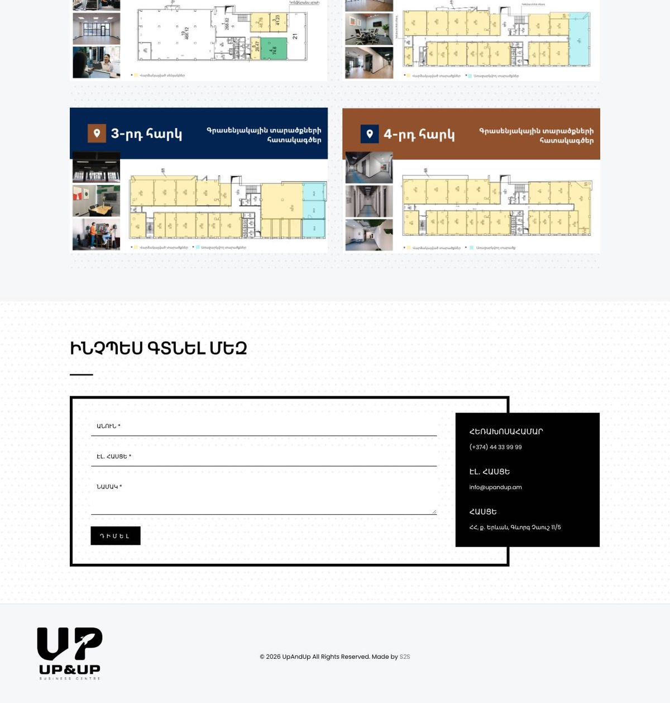
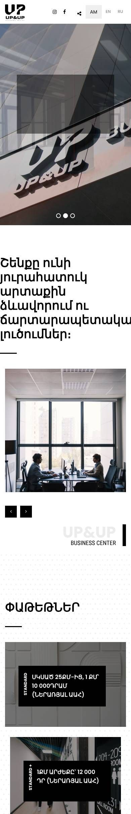

# Ռեֆերենս կայքի վերլուծություն — upandup.am

> Նպատակ. հասկանալ, թե ինչն է GARON Construction-ի սեփականատիրոջը դուր գալիս upandup.am-ում, և ինչ դիզայնի որակ ենք ուզում վերցնել։ Սա **միայն վերլուծություն** է. նրանց տեքստերը, լոգոն, լուսանկարները մեր կայքում չենք օգտագործում։
>
> Ստուգման ամսաթիվ՝ 2026-11-17։ Գործիքներ՝ Playwright/Chromium (desktop 1440px, iPhone 13), HTML/CSS վերլուծություն, ցանցի հարցումների չափում։
> Սքրինշոթեր՝ `ref/` թղթապանակում (տե՛ս ստորև)։

---

## Ամփոփում

- **Ի՞նչ կայք է իրականում.** upandup.am-ը ոչ թե շինարարական ընկերության, այլ **UP&UP Business Centre** գրասենյակային կենտրոնի (Աջափնյակ, Գևորգ Չաուշ 11/5) **մեկ էջանոց (one-page) լենդինգ** է՝ վարձակալության փաթեթներով։ Կառուցողը/ձևավորողը՝ S2S ստուդիա։
- **Ինչու է «թանկ» երևում.** խիստ մոնոխրոմ (սև / սպիտակ / շատ բաց մոխրագույն) պալիտրա, սուր անկյուններ, հաստ սև շրջանակներ ու «offset» բլոկներ, մեծ գունատ watermark-տեքստեր, **շատ որակյալ պրոֆեսիոնալ ինտերիերի լուսանկարներ** (ճարտարապետական ֆոտոշարք), մեծ դատարկ տարածություն։ Տպավորությունը՝ ճարտարապետական բյուրոյի/պրեմիում անշարժ գույքի։
- **Տեխնիկապես՝ թույլ.** 2023-ին HTTrack-ով պատճենված պատրաստի HTML շաբլոն (thememajestic «Modern»), PHP/CodeIgniter-ի վրա. **~183 ՄԲ էջ** (լուսանկարները 5472×3648, 8–25 ՄԲ յուրաքանչյուրը, ցուցադրվում են 240px-ով), jQuery-ն բեռնվում է 3–4 անգամ, SEO-ն գրեթե բացակայում է (դատարկ description, մնացած «Bit 1024» վերնագիր, H1 չկա), alt-եր չկան, մոբայլում վերնագրերը կտրվում են։
- **Եզրակացություն GARON-ի համար.** վերցնում ենք **վիզուալ լեզուն** (մոնոխրոմ + մեկ զուսպ ակցենտ, շրջանակներ, zigzag բլոկներ, մեծ ֆոտոներ, watermark-տիպոգրաֆիա, քանակական փաստեր), բայց կառուցում ենք **արագ, բազմաէջ, SEO-պատրաստ, մոբայլ-առաջնային** կայք՝ հստակ CTA-ներով (զանգ, WhatsApp/Viber, հաշվարկի հայտ), պորտֆոլիոյով և վստահության տարրերով, որոնք upandup-ում բացակայում են։

---

## Էջեր և կառուցվածք

### Էջերի քարտեզ

| URL | Վիճակ | Նշում |
|---|---|---|
| `/` (AM) | 200, ~17 700px բարձրություն desktop-ում, ~21 300px մոբայլում | Ամբողջ կայքը մեկ էջում |
| `/eng/`, `/rus/` | 200 | Նույն էջի թարգմանություններ |
| `www.upandup.am` | 200 | Redirect չկա → դուբլիկատ |
| `/about` | 200, բայց **դատարկ** էջ՝ `<title>Bit 1024</title>` | Շաբլոնի մնացորդ |
| `/contact` | 404 | |
| `/sitemap.xml` | **500 սխալ** | |

**Վերին մենյու չկա** — HTML-ում նավիգացիան մեկնաբանված է (`<!-- -->`)։ Հեդերում միայն լոգո, email, Instagram/Facebook, լեզվի փոխանջատիչ։ Այսինքն «ամեն top-menu էջ» պարզապես գոյություն չունի. վերլուծվել են AM/EN/RU տարբերակները (desktop + mobile)։

### Գլխավոր էջի բաժինների հերթականությունը

1. **Hero սլայդեր** (Revolution Slider, 3 սլայդ, boxed 1280×690) — մուգ կիսաթափանցիկ տեքստային արկղ նկարի կենտրոնում, մեծ քառակուսի սլաքներ (80×80, սպիտակ, բարակ եզր), կլոր bullet-ներ ներքևում։ Ֆոտո՝ շենքի ճակատ, դատարկ գրասենյակ, լաունջ։
2. **«Շենքը ունի յուրահատուկ արտաքին ձևավորում…»** — մեծ վերնագիր + կարճ սև գիծ + 5 ուղղահայաց ֆոտոյի carousel (Owl), սև/մոխրագույն քառակուսի սլաքներ։
3. Watermark «UP&UP / BUSINESS CENTER» (գունատ 80px տեքստ + սև ուղղահայաց շերտ)։
4. **Փաթեթներ** — bento/mosaic դասավորություն. 4 ֆոտո-սալիկ, յուրաքանչյուրի վրա սև պիտակ-արկղ՝ ուղղահայաց գրված փաթեթի անունով (STANDARD / STANDARD+ / PREMIUM) և գնով (10 000–16 000 դր/քմ). սեղմելիս բացվում է modal՝ ներառված ծառայությունների ցուցակով։
5. **Հետաքրքիր փաստեր** — parallax մուգ ֆոն, շրջանակված վերնագիր, 3 counter (80+ աշխատասենյակ, 7000 մ², 100+ կայանատեղի)։
6. **Մատուցվող ծառայություններ** — ամբողջովին սև ֆոն, ձախ/աջ outline-արկղեր (սպիտակ 2px եզր), մեջտեղում ուղղահայաց ֆոտո, արկղերը բացում են modal-ներ։
7. **Մեր առավելությունները** — ~15 հերթափոխվող (zigzag) բլոկ. մեծ ֆոտո + վրան մասամբ «նստած» սպիտակ կամ սև քարտ (overlap ~35px), կետավոր (dot-pattern) ֆոն։
8. **Բարի գալուստ** (about) — մեծ վերնագիր + 2 պարբերություն + ֆոտո՝ մոխրագույն offset շրջանակով։
9. Կրկին zigzag բլոկներ՝ քովորքինգ, սրճարան, EV լիցքավորում, Face-ID, կայանատեղի, սուրճ, մաքրություն, ավտոլվացում։
10. **Հարկերի հատակագծեր** — 4 նկար-քարտ (lightbox)։ Ինքնին նկարներ են (տեքստը նկարում)։
11. **Ինչպես գտնել մեզ** — ձև (անուն, email, նամակ) հաստ սև շրջանակում + սև կոնտակտային քարտ (հեռախոս, email, հասցե)։ **Քարտեզ չկա**, չնայած վերնագրին։
12. **Ֆութեր** — լոգո + © տող + «Made by S2S»։ Ոչ մենյու, ոչ սոցցանցեր, ոչ աշխատանքային ժամեր։

Սքրինշոթեր.

---

## Դիզայն համակարգ

### Գույներ (չափված computed style-ից)

| Դեր | Hex | Կիրառություն |
|---|---|---|
| Հիմնական մուգ | `#000000` | տեքստ, սև բաժիններ, պիտակներ, կոճակներ, շրջանակներ |
| Սպիտակ | `#FFFFFF` | ֆոն, տեքստ մուգ ֆոնի վրա, քարտեր |
| Բաց մոխրագույն ֆոն | `#F6F7F8` | «Առավելություններ» և այլ բաժինների ֆոն |
| Մուգ մոխրագույն | `#1A1A1A`, `#333` (փաստերի բլոկ) | |
| Երկրորդային տեքստ | `#767676` / `#787878` | |
| Watermark | `rgba(191,191,191,.3)` | մեծ գունատ «UP&UP / BUSINESS» |
| Overlay | `rgba(0,0,0,.5)` | hero-ի տեքստային արկղ |
| Եզակի ակցենտներ | ~`#8B4A2B` (դարչնագույն), ~`#0F2A5C` (մուգ կապույտ) | միայն հատակագծերի նկարներում, համակարգային չեն |

Իրականում **ակցենտային գույն չկա** — ամբողջ «գույնը» գալիս է լուսանկարներից (նարնջագույն գորգ, կանաչ թավիշ, կապույտ ընդունարան)։ Սա է պրեմիում զգացողության հիմնական պատճառներից մեկը։

### Տառատեսակներ

- **Poppins** 300/400/500/600/700 (Google Fonts) — ամբողջ կայքը։ **Crete Round** և **Roboto Condensed** նույնպես բեռնվում են. Roboto Condensed-ը միայն watermark-ի «BUSINESS CENTER» ենթագրի համար։
- **Կարևոր.** Poppins-ը **հայերեն գլիֆներ չունի** → հայերեն տեքստը ցուցադրվում է օպերացիոն համակարգի fallback տառատեսակով (Windows-ում՝ Sylfaen/Arial, Mac-ում՝ Mshtakan և այլն)։ Այսինքն հայերեն տարբերակի տիպոգրաֆիան **անվերահսկելի է** և տարբեր սարքերում տարբեր տեսք ունի։ GARON-ի համար պետք է ընտրել հայերեն աջակցող տառատեսակ (օր. Noto Sans Armenian, Montserrat Armenian, «Mardoto», «Arian AMU» և այլն — ստուգել լիցենզիան)։

| Էլեմենտ | Չափ / քաշ |
|---|---|
| Hero վերնագիր | ~55–60px, 600–700 |
| Counter-ներ | 24–80px, 600–700 |
| H2 (բաժնի վերնագիր) | 36px / 42px, 600, հաճախ UPPERCASE |
| H3 (քարտի վերնագիր) | 17–26px, 600, UPPERCASE |
| Body | **12px** / 24px line-height (շատ փոքր) |
| Կոճակ | 14px, UPPERCASE, letter-spacing լայն |

Վերնագրի տակ միշտ **50px երկարությամբ 3px սև գիծ** — ամբողջ կայքի «ստորագրությունը»։

### Grid և տարածություններ

- Bootstrap 4, բովանդակության լայնություն ≈ **1140px** (150–1290px 1440 էկրանում), hero-ն boxed 1280px։
- Բաժինների padding՝ **90–140px** վերևից, 80px կողքերից. շատ «օդ»։
- Zigzag բլոկներ՝ 50/50, նկար 555px + քարտ 620px՝ նկարի վրա 35px overlap-ով։
- Բլոկների միջև 120px+ ուղղահայաց տարածություն։

### Էլեմենտներ

- **Անկյուններ՝ 0px** ամենուր (border-radius չկա)։
- **Շրջանակներ.** 15px հաստությամբ սև/սպիտակ outline, որը տեղաշարժված է բովանդակությունից (offset frame) — փաստերի վերնագիր, Premium փաթեթ, կոնտակտային ձև, about ֆոտո։
- **Կոճակներ.** սև ուղղանկյուն, սպիտակ UPPERCASE տեքստ, լայն տառաբացում («Դ Ի Մ Ե Լ»), padding 10×20, radius 0։
- **Քարտեր.** սպիտակ կամ սև հարթ քարտ, ստվեր չկա, 30px ներքին padding, պիտակ-ենթավերնագիր + վերնագիր + տեքստ։
- **Ֆոնային տեքստուրա.** բաց կետավոր pattern (`ptn-1.png`)։
- **Watermark տիպոգրաֆիա.** մեծ գունատ բառ + փոքր մուգ ենթագիր + սև ուղղահայաց շերտ աջից. բաժանարար բաժինների միջև։
- **Ուղղահայաց տեքստ** փաթեթների պիտակներում (rotate −90°)։

### Header / նավիգացիա

- Sticky սպիտակ header (~130px բարձր desktop-ում, մեծ լոգո), ոլորելիս մնում է վերևում։
- Աջ կողմում՝ email (icon-ով), Instagram, Facebook, **AM / EN / RU** (ակտիվը՝ մոխրագույն ֆոնով արկղ)։
- **Չկան.** մենյու, հեռախոս header-ում, «Կապվել/Դիմել» CTA կոճակ, hamburger մոբայլում (որովհետև մենյու չկա)։

### Լուսանկարների ոճ

- Պրոֆեսիոնալ ինտերիերի ֆոտոշարք (նոյ. 2024), բնական լույս, լայն անկյուն, ուղիղ ուղղահայացներ, մաքուր տարածքներ, քիչ մարդիկ (մարդիկ՝ «կյանք» ավելացնելու համար, մի մասը շարժման մեջ մշուշված)։ Մի քանի stock նկար (ավտոլվացում, EV) — ակնհայտորեն ավելի «էժան» են երևում իրենց ֆոնին։
- Ուղղահայաց (portrait) կադրեր carousel-ում և zigzag-ում → ամսագրային տեսք։

---

## Անիմացիաներ և ինտերակտիվություն

Ստուգված է կադր առ կադր (300ms, 1.8s, load, +6s, ոլորման ժամանակ early/late)։

| Էֆեկտ | Կա՞ | Մանրամասն |
|---|---|---|
| Preloader | Այո | Hero-ի տեղում մոխրագույն (#EEE) ֆոն + 3 կետ (Revolution Slider loader), ~1–2վ |
| Hero սլայդեր | Այո | Revolution Slider, ավտոմատ փոխվում է (~6–8վ), տեքստային շերտերը մտնում են անիմացիայով. **սկզբում երբեմն երևում են սպիտակ դատարկ ուղղանկյուններ** (layer-ները դեռ չեն բեռնվել) — անհարթ առաջին տպավորություն |
| Վիդեո hero | Ոչ | |
| Parallax | Այո | Stellar.js — «Հետաքրքիր փաստեր» բաժնի ֆոնը (ratio 0.5) |
| Counter-up | Այո | Waypoints + CounterUp, թվերը «հաշվում են» տեսադաշտ մտնելիս |
| Carousel | Այո | Owl Carousel (գալերեա), Slick |
| Scroll reveal | Գործնականում ոչ | scrolla.js-ը բեռնված է, բայց ոլորման կադրերում տարբերություն չկա. բլոկները հայտնվում են ստատիկ |
| Hover | Թույլ | Շաբլոնի overlay/zoom կլասները կան CSS-ում, բայց բովանդակային բլոկների վրա քիչ են կիրառված. carousel-ի նկարների վրա ծածկող div-ը «խլում» է hover-ը |
| Modal-ներ | Այո | 16 modal (փաթեթներ, ծառայություններ)՝ սպիտակ արկղ, մեծ X, պարզ ցուցակ (դիզայնը՝ «հում», ոչ ոճավորված) |
| Lightbox | Այո | Հատակագծերի համար |
| Back-to-top | Այո | Սև քառակուսի կոճակ ներքևի աջ անկյունում |

Ընդհանուր առմամբ շարժումը **զուսպ է** — սա դրական է պրեմիում զգացողության համար, բայց բացակայում են ժամանակակից նուրբ fade/slide-up reveal-ները, որոնք էժան են և շատ են բարձրացնում «polish»-ը։

---

## Բովանդակություն և վստահության տարրեր

| Տարր | Առկա՞ | Նշում |
|---|---|---|
| Գներ / փաթեթներ | Այո | 4 մակարդակ, գինը քմ-ով, modal-ում ցուցակ — ուժեղ թափանցիկություն |
| Քանակական փաստեր (stats) | Այո | 3 counter |
| Պորտֆոլիո / նախագծեր | Ոչ (մեկ շենք) | Գալերեա + հատակագծեր |
| Հաճախորդների կարծիքներ | **Ոչ** | |
| Թիմ | **Ոչ** | |
| Հավաստագրեր / լիցենզիաներ | **Ոչ** | |
| Գործընկերներ / վարձակալների լոգոներ | **Ոչ** | |
| Բլոգ / նորություններ | **Ոչ** | |
| Հաշվիչ (calculator) | **Ոչ** | Գինը/քմ կա, բայց հաշվիչ չկա |
| FAQ | **Ոչ** | |
| Քարտեզ | **Ոչ** | Վերնագիրը «Ինչպես գտնել մեզ» է, բայց Google/Yandex քարտեզ չկա |
| Կոնտակտային ձև | Այո | Անուն, email, նամակ. **հեռախոսի դաշտ չկա**, label-ներ չկան (placeholder), հաջողության/սխալի վիճակը չի երևում |
| Հեռախոս | Միայն էջի վերջում | `tel:` հղում կա, բայց header-ում/hero-ում չկա |
| WhatsApp / Viber / Telegram | **Ոչ** | Հայաստանում հիմնական կապուղիներն են |
| Սոցցանցեր | Instagram, Facebook header-ում | Հղումները տանում են **«Bit1024»** էջեր (հին բրենդ) |
| Լեզուներ | AM / EN / RU | Առանձին URL-ներ, բայց hreflang չկա |
| Աշխատանքային ժամեր | Ոչ | |

---

## Տեխնիկա/SEO/արագություն

### Stack

- Backend՝ PHP, **CodeIgniter** (`ci_session` cookie, HTML-ում մնացած `<*?= base_url(); ?>`), Cloudflare CDN։ **WordPress չէ**։
- Frontend՝ **thememajestic «Modern»** HTML շաբլոն, որը HTTrack-ով պատճենված է 2023-02-22-ին (մեկնաբանությունը մնացել է կոդում)։ Շաբլոնի մնացորդներ՝ `index-2.html`, `news-grid.html`, `post-video.html`, որոնման ձև՝ `thememajestic.com/search`։
- Գրադարաններ՝ Bootstrap, **jQuery 3–4 անգամ** (1.12.4, 3.6.1 ajax.googleapis, 3.6.1 code.jquery, լոկալ), Revolution Slider, Owl Carousel, Slick, Isotope, Magnific Popup, Lightbox, Stellar, Waypoints, CounterUp, Scrolla, Font Awesome 4։
- Cart/wishlist cookie-ներ (`cart_session_id`, `wishlist_session_id`) — e-commerce CMS-ի մնացորդ։

### Արագություն (չափված)

| Ցուցանիշ | Արժեք |
|---|---|
| Ընդհանուր էջի քաշ | **≈183 ՄԲ** (90 հարցում) |
| Նկարներ | ≈181.5 ՄԲ |
| JS / CSS / fonts | 751 ԿԲ / 468 ԿԲ / 180 ԿԲ |
| Ամենամեծ նկարը | 25.9 ՄԲ PNG; 8–14 ՄԲ JPG-եր (5472×3648) |
| Լոգո | 3188×2550 PNG՝ ցուցադրվում 140px լայնությամբ |
| Գալերեայի նկարներ | 5472×3648 ցուցադրվում են **240px**-ով |
| Lazy loading | 0 / 46 նկար |
| WebP/AVIF, srcset | Ոչ |
| Cache-Control | `no-store, no-cache` (HTML-ի համար) |
| `load` իրադարձություն | 3–12.5վ արագ datacenter կապով; 4G մոբայլում՝ կես րոպեից ավելի, իսկ 183 ՄԲ-ը սպառում է բջջային տրաֆիկ |

Սա կայքի **ամենամեծ թերությունն է**. նույն վիզուալ արդյունքը կարելի էր ստանալ ~2–3 ՄԲ-ով։

### SEO

- `<title>UpAndUp</title>` + **երկրորդ `<title>Bit 1024</title>`** նույն էջում։
- `meta description` — դատարկ; `og:description`, `og:image` — դատարկ (սոցցանցերում կիսվելիս նկար չի լինի)։
- **H1 չկա**, 29 H2, 17 H3 — վերնագրերի հիերարխիա չկա։
- `<html lang="en">` հայերեն էջում; hreflang չկա; www/non-www դուբլիկատ; sitemap.xml → 500։
- Schema.org (JSON-LD, LocalBusiness) չկա։ Canonical կա։
- Տեքստի մեծ մասը կա HTML-ում (լավ), բայց հատակագծերը միայն նկար են։

### Մատչելիություն (a11y)

- 46/46 նկարից **ոչ մեկը alt չունի**։
- 18 հղում/կոճակ առանց տեքստի կամ aria-label (սլաքներ, սոց. icon-ներ); `href="javscript:;"` տառասխալներ։
- Ձևի դաշտերը **label չունեն** (միայն placeholder)։
- Body տեքստ **12px** — դժվարընթեռնելի, հատկապես հայերեն fallback տառատեսակով։
- Հայերեն UPPERCASE վերնագրեր — հայերեն մեծատառ երկար բառերը դժվար են կարդացվում։
- Hero տեքստը նկարի վրա 50% overlay-ով — որոշ սլայդներում կոնտրաստը սահմանային է։
- Մոբայլում H2 վերնագրերը **դուրս են գալիս էկրանից և կտրվում** («…ճարտարապետակա», «…ԾԱՌԱՅՈՒԹՅՈՒՆՆԵ»)՝ երկար հայերեն բառերի համար hyphenation/font-size clamp չկա։
- Մոբայլում հատակագծերը 2 սյունով ~170px — անընթեռնելի։

---

## Ինչն է լավ

1. **Զուսպ մոնոխրոմ պալիտրա** — սև/սպիտակ/#F6F7F8, ակցենտը թողնված է լուսանկարներին. անմիջապես «ճարտարապետական», «պրեմիում» տպավորություն։
2. **Լուսանկարների որակ և միասնականություն** — մեկ պրոֆեսիոնալ ֆոտոշարք, նույն լույս ու գունային մշակում։ Սա է որակի 70%-ը։
3. **Գրաֆիկական «ստորագրություն»** — offset շրջանակներ, վերնագրի տակ կարճ սև գիծ, watermark-տիպոգրաֆիա, ուղղահայաց պիտակներ. քիչ միջոցներով ճանաչելի ոճ։
4. **Ռիթմ և «օդ»** — մեծ padding-ներ, zigzag-ի հերթափոխում սպիտակ/սև քարտերով, սև ամբողջական բաժիններ՝ կոնտրաստային «դադարի» համար։
5. **Սուր անկյուններ, ստվերներ չկան** — հարթ, «շինարարական/ինժեներական» գրաֆիկա։
6. **Գների թափանցիկություն** — փաթեթներ գներով հենց գլխավոր էջում։
7. **Քանակական փաստեր** — 80+ / 7000 մ² / 100+, parallax ֆոնով։
8. **Հատակագծեր** — կոնկրետ, «շոշափելի» ինֆորմացիա (GARON-ի համար՝ նախագծի գծագրեր/3D)։
9. **Եռալեզու** AM/EN/RU — սփյուռքի և ռուսախոս հաճախորդների համար։
10. **Զուսպ անիմացիա** — ոչինչ չի «պարում», ինչը պրեմիում սեգմենտին համապատասխանում է։

## Ինչն է թույլ

1. **183 ՄԲ էջ** — չսեղմված 5472px նկարներ, lazy-load չկա. մոբայլում գրեթե անօգտագործելի։
2. **Չկա նավիգացիա և բազմաէջ կառուցվածք** — մեկ 21 000px երկար էջ, որտեղ ոչինչ չես գտնում, SEO-ի համար՝ մեկ URL ամեն ինչի համար։
3. **CTA-ների բացակայություն** — hero-ում կոճակ չկա, header-ում հեռախոս չկա, WhatsApp/Viber չկա. միակ ձևը էջի ամենավերջում է։
4. **Վստահության տարրեր չկան** — կարծիքներ, թիմ, լիցենզիաներ, գործընկերներ, քարտեզ։
5. **SEO զրոյական մակարդակի** — դատարկ description/OG, կրկնակի title «Bit 1024», H1 չկա, lang="en", sitemap-ը կոտրված։
6. **Հայերեն տիպոգրաֆիա** — Poppins-ը հայերեն չունի. ամեն սարքում տարբեր fallback, 12px body, երկար UPPERCASE վերնագրեր, մոբայլում կտրվող վերնագրեր։
7. **Կրկնվող zigzag** — ~20 նույն ձևաչափի բլոկ անընդմեջ → ձանձրալի, «անվերջ ոլորում»։
8. **Հին շաբլոն/հնացած stack** — HTTrack պատճեն, 3–4 jQuery, Revolution Slider, Font Awesome 4, շաբլոնի մնացորդային հղումներ, սոցցանցերը՝ հին «Bit1024» բրենդի։
9. **Անհարթություններ** — hero-ի բեռնման պահին սպիտակ դատարկ ուղղանկյուններ, ոչ ոճավորված modal-ներ, stock ֆոտոներ պրոֆեսիոնալների կողքին, «Ինչպես գտնել մեզ» առանց քարտեզի, դատարկ վերնագրով բաժին (հատակագծերի առաջ միայն գիծ)։
10. **a11y** — alt-եր չկան, label-ներ չկան, առանց անվան կոճակներ։

---

## Ինչ արժե վերցնել GARON-ի համար (top 10, prioritized)

1. **Մոնոխրոմ հիմք + մեկ ակցենտ.** սև `#0A0A0A` / սպիտակ / բաց մոխրագույն `#F5F6F7` + GARON-ի մեկ բրենդային ակցենտ (օր. լողավազանների համար ջրային կապույտ կամ «բետոնի» տաք օխրա)՝ միայն CTA-ների և մանր դետալների համար։ Գույնը թողնել ֆոտոներին։
2. **Պրոֆեսիոնալ ֆոտոշարք՝ ամենամեծ ներդրումը.** մեկ ֆոտոգրաֆ, միասնական գունամշակում, ավարտված օբյեկտներ (լողավազան երեկոյան լույսով, տան ճակատ, վերանորոգված ինտերիեր), լրացուցիչ՝ «before/after» և կառուցման պրոցես։ Stock նկարներ չօգտագործել։
3. **Գրաֆիկական ստորագրություն.** offset շրջանակ, վերնագրի տակ կարճ գիծ, watermark-բառեր («POOLS», «HOUSES», «RENOVATION»)՝ սեփական ձևով, սուր անկյուններ, առանց ստվերների։
4. **Արագությունը՝ պարտադիր պահանջ.** AVIF/WebP + srcset, lazy-load, առավելագույնը ~1.5–2.5 ՄԲ էջի համար, LCP < 2.5վ մոբայլում, առանց jQuery/Revolution Slider (vanilla JS կամ ստատիկ գեներատոր)։
5. **Hero՝ մեկ ուժեղ կադր կամ կարճ լուռ վիդեո (≤3 ՄԲ)** + հստակ H1 («Լողավազաններ, տներ և վերանորոգում Երևանում») + 2 CTA՝ «Ստանալ հաշվարկ» և «Զանգել / WhatsApp»։ Սլայդեր՝ ոչ (կամ նվազագույնը)։
6. **Բազմաէջ կառուցվածք + sticky header մենյուով.** Գլխավոր, Լողավազաններ, Տներ, Վերանորոգում, Նախագծեր (պորտֆոլիո), Մեր մասին, Կոնտակտ. header-ում հեռախոս և CTA կոճակ, մոբայլում՝ ներքևի sticky «Զանգ / WhatsApp / Viber» գոտի։
7. **«Փաթեթներ գներով» գաղափարը՝ GARON-ի ձևով.** վերանորոգման փաթեթներ (սպիտակ/սև/բանալի հանձնում) «սկսած … դր/մ²», + պարզ **հաշվիչ** (մակերես × փաթեթ → մոտավոր գին) → հայտի ձև։ upandup-ում սա չկա, մեզ մոտ կլինի ուժեղ առավելություն։
8. **Counter-ներ և փաստեր** (կառուցված օբյեկտներ, մ², տարիներ, երաշխիք տարիներով) parallax կամ մուգ ֆոնի վրա + **վստահության բլոկ**՝ կարծիքներ, թիմ, լիցենզիա, երաշխիք, գործընկեր-մատակարարներ, Google Maps քարտեզ։
9. **Zigzag ծառայությունների բլոկներ՝ չափավոր.** առավելագույնը 3–5 հերթափոխվող բլոկ մեկ էջում, միջև՝ սև «դադար» բաժին կամ պորտֆոլիո grid. նուրբ fade-up reveal (IntersectionObserver, `prefers-reduced-motion`-ով), hover-ին՝ նկարի դանդաղ zoom 1.03–1.05։
10. **Հայերեն տիպոգրաֆիա և SEO/a11y հիմքեր ի սկզբանե.** հայերեն աջակցող տառատեսակ (self-hosted, subset), body 16–18px, վերնագրեր՝ `clamp()` + `hyphens`/`overflow-wrap`, UPPERCASE միայն կարճ պիտակների համար; յուրաքանչյուր էջ՝ եզակի title/description/OG, H1, `lang="hy"`, hreflang AM/EN/RU, LocalBusiness JSON-LD, sitemap, alt-եր, label-ներով ձև (անուն, **հեռախոս**, ծառայության տեսակ)։

---

*Սքրինշոթերի ամբողջական հավաքածուն (desktop/mobile full-page, անիմացիայի կադրեր) պահված է աշխատանքային scratchpad-ում և չի մտնում ռեպոզիտորիա։*
